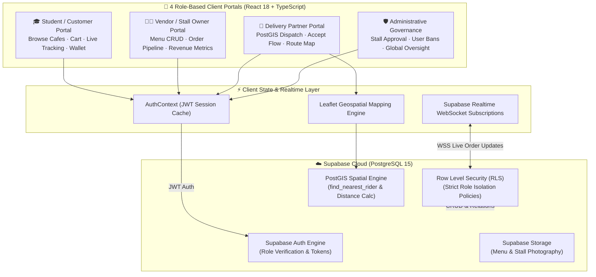

# 🍱 MyUSM Eats: Campus Cafeteria Online Ordering & Multi-Role Logistics Platform

[](https://react.dev)
[](https://www.typescriptlang.org)
[](https://vitejs.dev)
[](https://tailwindcss.com)
[](https://supabase.com)
[](https://postgis.net)
[](LICENSE)

> **Universiti Sains Malaysia (USM) Web Application Project**  
> **Author:** Jarren Hong (Hong Soon Chuan)  
> **Key Domains:** Full-Stack Web Architecture, Role-Based Access Control (RBAC), Row Level Security (RLS), Real-Time WebSockets, Geospatial Dispatching (PostGIS).

---

## 📌 Executive Overview

**MyUSM Eats** is a unified, multi-role campus food ordering and delivery logistics ecosystem developed for Universiti Sains Malaysia (USM). It bridges the gap between students residing across campus hostels (Desasiswa Tekun, Aman Damai, Fajar Harapan, Bakti Permai, Indah Kembara, Saujana), independent cafeteria stall vendors, on-campus student delivery riders, and campus administrators.

Built on a serverless, event-driven architecture using **React 18, Vite, TypeScript, and Supabase (PostgreSQL + PostGIS)**, the platform replaces fragmented manual messaging and cash-on-delivery chaos with real-time order tracking, automated nearest-rider dispatching, automated stall registration gates, and institutional governance oversight.

---

## 🏛️ System Architecture



---

## 🔑 Key Features Across 4 Role Portals

### 1. 🎓 Student & Customer Portal (`/src/components/Student/`)
* **Hostel Cafeteria Browsing:** Filter stalls and menus across USM residential colleges (Tekun, Aman Damai, Fajar Harapan, Bakti Permai, Indah Kembara).
* **Category Filtering:** Rapid discovery across culinary categories (*Rice, Noodles, Western, Drinks, Snacks*).
* **Interactive Cart & Checkout:** Persistent shopping cart, special preparation notes per item, promo code verification, and credit wallet deduction.
* **Live Order Progression:** Real-time visual progress tracker powered by Supabase WebSockets:
  $$\text{Pending} \longrightarrow \text{Accepted} \longrightarrow \text{Preparing} \longrightarrow \text{Picked Up} \longrightarrow \text{Delivered}$$
* **Order History & Reviews:** Transparent past order logs and multi-dimensional ratings (overall, food quality, delivery speed).

### 2. 👨‍🍳 Vendor & Stall Management (`/src/components/Vendor/`)
* **Stall Registration Gate:** Step-by-step onboarding wizard requiring administrative approval before stall listing goes live.
* **Menu Engineering (CRUD):** Add, modify, or toggle item availability, pricing, preparation duration, and dietary labels.
* **Order Kanban Pipeline:** Interactive order cards with audio/visual notification bells for incoming orders, status transitions, and rider handoffs.
* **Revenue & Sales Analytics:** Daily and monthly gross revenue calculations with item-level velocity charts.

### 3. 🛵 Delivery Partner Logistics (`/src/components/Delivery/`)
* **Automated PostGIS Dispatch:** Ingests incoming orders ready for pickup and assigns them to the nearest available campus rider using spatial coordinate bounding.
* **Delivery Lifecycle Workflow:** Modal dispatch acceptance, one-click status transitions (`assigned` $\rightarrow$ `picked_up` $\rightarrow$ `en_route` $\rightarrow$ `delivered`).
* **Route Visualization:** Integrated Leaflet map rendering pickup stall locations and student hostel drop-off pins.
* **Earnings Ledger:** Automated commission tracking per completed delivery.

### 4. 🛡️ Administrative Governance (`/src/components/Admin/`)
* **Stall Lifecycle Approvals:** Review and verify pending vendor registration applications and stall menu updates.
* **User Management & Security:** Role audit table with capabilities to suspend, reactivate, or initiate password reset workflows.
* **Global Order Oversight:** Real-time visibility into all active orders, delivery bottlenecks, and cancellation reasons across campus.
* **Audit Logging & Report Export:** Aggregated platform health metrics, transaction volume summaries, and CSV data export.

---

## 💾 Relational Database Schema & PostGIS Functions

The data tier is deployed on **PostgreSQL 15** in Supabase, protected by comprehensive **Row Level Security (RLS)** ensuring users only query records authorized for their role:

| Relational Table | Core Attributes & Foreign Keys | Security & Business Purpose |
| :--- | :--- | :--- |
| **`profiles`** | `id (FK auth.users)`, `role`, `matric_id`, `phone`, `hostel_address`, `credit_balance`, `is_active` | Extends auth with USM campus metadata and role access flags. |
| **`cafes`** | `id`, `vendor_id (FK profiles)`, `name`, `location`, `operating_hours` | Host cafeteria buildings and management contracts. |
| **`stall`** | `id`, `cafe_id (FK cafes)`, `name`, `status (pending/approved)`, `categories` | Individual vendor food stalls subject to admin approval. |
| **`menu_items`** | `id`, `stall_id (FK stall)`, `name`, `price`, `prep_time`, `is_available`, `image_url` | Food and beverage catalog items with pricing and prep limits. |
| **`orders`** | `id`, `order_number`, `customer_id (FK profiles)`, `stall_id`, `status`, `payment_status`, `total` | Central order transactions with state validation triggers. |
| **`order_items`** | `id`, `order_id (FK orders)`, `menu_item_id`, `quantity`, `special_instructions` | Line-item detail junction table. |
| **`deliveries`** | `id`, `order_id`, `rider_id (FK profiles)`, `status`, `current_location (geometry)` | Spatial tracking coordinates and delivery lifecycle stamps. |
| **`reviews`** | `id`, `order_id`, `customer_id`, `rating`, `food_rating`, `service_rating`, `comment` | Multi-criteria customer feedback and vendor response threads. |
| **`promo_codes`** | `code`, `discount_type`, `discount_value`, `min_spend`, `valid_until`, `usage_limit` | Discount promotional vouchers with validation constraints. |

### Automated Spatial Stored Procedures:
* **`auto_assign_delivery(order_id)`**: Triggers on order state transition to `ready`, invoking `find_nearest_rider()` to calculate Euclidean/Manhattan distance over PostGIS coordinates and link the order to the closest active rider.
* **`update_delivery_location(rider_id, lat, lng)`**: Ingests GPS telemetry updates, broadcasting position coordinates via Supabase Realtime to the customer's Leaflet tracking interface.

---

## 🗂️ Project Directory Structure

```text
usm-cafeteria-online-ordering-fix/
├── .env.example                       # Environment configuration template
├── PROJECT_STRUCTURE.md               # Technical specification & component index
├── ADMIN_MODULE_README.md             # In-depth admin workflow documentation
├── CLASS_DIAGRAM.md                   # Complete UML class definitions
├── ARCHITECTURE_DIAGRAM_INPUT.md      # Dataflow and system boundary specifications
├── index.html                         # SPA entry point
├── package.json                       # Dependencies & scripts
├── vite.config.ts                     # Vite bundle optimization
├── tailwind.config.js                 # Campus-themed UI styling
├── supabase/
│   └── migrations/                    # PostgreSQL schemas, RLS rules & triggers
└── src/
    ├── lib/
    │   └── supabase.ts                # Initialized Supabase client & DB types
    ├── contexts/
    │   └── AuthContext.tsx            # Multi-role authentication & session provider
    └── components/
        ├── Layout.tsx                 # Responsive navigation bar & role switches
        ├── Auth/                      # LoginForm.tsx & RegisterForm.tsx
        ├── Student/                   # StudentDashboard, MenuList, Cart, Checkout
        ├── Vendor/                    # VendorDashboard, Menu CRUD, OrderCard, StallAdmin
        ├── Delivery/                  # DeliveryDashboard, DeliveryMap, DispatchAccept
        └── Admin/                     # AdminDashboard, CafeApproval, UserManagement
```

---

## 🚀 Quick Start & Local Setup

### Prerequisites
* **Node.js 18+** & **npm**
* A free **Supabase** cloud project (or local Supabase CLI instance)

### 1. Clone & Install Dependencies
```bash
git clone https://github.com/hongjarren/usm-cafeteria-online-ordering-fix.git
cd usm-cafeteria-online-ordering-fix

npm install
```

### 2. Configure Environment Variables
Copy `.env.example` to `.env` and fill in your Supabase credentials:
```bash
cp .env.example .env
```
In `.env`:
```env
VITE_SUPABASE_URL=https://your-project.supabase.co
VITE_SUPABASE_ANON_KEY=your-anon-key
```

### 3. Initialize Database Migrations
Execute the SQL migrations found in `supabase/` directly within your Supabase SQL Editor to initialize the 9 core tables, RLS security policies, and PostGIS delivery procedures.

### 4. Run Development Server
```bash
npm run dev
```
*Access the application at: `http://localhost:5173`*

---

## 📜 License
This project is open-source under the [MIT License](LICENSE).  
Developed for the **School of Computer Sciences, Universiti Sains Malaysia (USM)**.
